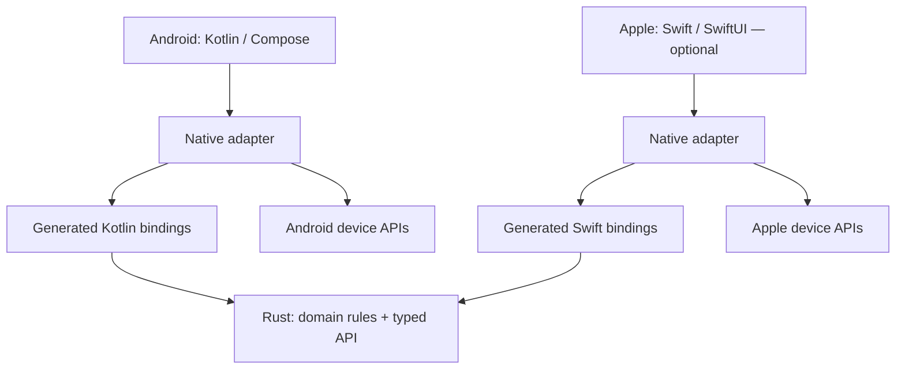

# Architecture

**Status:** intended design; starter tooling exists, but no application code. Rust + UniFFI is the default
shared-core approach. Android is the only initially selected platform.

## What lives where

| Concern | Default owner |
| --- | --- |
| Product rules, validation, calculations, portable state transitions | Rust |
| Shared structured data and domain errors crossing the boundary | Rust definitions → UniFFI |
| Screens, navigation, animation, formatting, local UI state | Kotlin / Swift |
| Lifecycle, background tasks, permissions, notifications, media, sensors | Native platform APIs |
| Credentials and encryption-key storage | Native Keychain / Keystore-backed storage |
| HTTP requests, TLS, connectivity, OS-managed transfers | Native transport by default |
| Durable domain data | One selected owner; Rust storage when sharing it earns its cost |
| UI preferences, presentation caches | Native unless they are shared product behavior |
| Server | Optional, separately designed only when required |

Native adapters are real application code: they translate device events to domain inputs,
execute platform effects, and expose observable state. They can use idiomatic view models,
repositories, actors, or simple classes. Do not force every UI decision through Rust.

## The first implementation

Start with one Rust crate under `core/`, one native project for the selected platform, and
one small feature. Place the UniFFI facade in that crate initially. Split domain and FFI crates
only if reuse, build isolation, or complexity justifies it. Add a workspace-pinned bindgen
tool when needed; do not depend on an unrelated global generator.

Use UniFFI proc macros as the default source of exported types. Avoid maintaining a second
UDL definition alongside equivalent Rust exports. Rust signatures are authoritative; the
[API note](docs/CORE-API.md) explains behavior, errors, ownership, and compatibility.

The first integration must prove a native call, returned structured data, a typed domain
error, and a release library load on the active target. Then build one useful screen.
See [docs/TOOLCHAIN.md](docs/TOOLCHAIN.md) for activation and reproducibility.

## A narrow boundary

- Prefer records, enums, stable IDs, explicit units, and typed errors supported by the selected
  UniFFI version. Keep platform views, handles, and SDK types on the native side.
- Batch meaningful operations. Do not send every animation frame, keystroke, or pixel through
  FFI. Use typed records over unversioned JSON strings for normal application calls.
- Pure domain functions take relevant time/randomness as inputs. Use monotonic time for elapsed
  durations and wall time for persisted instants; document units and time-zone rules when needed.
- Keep synchronous functions small. Run potentially blocking/expensive calls on a native worker
  executor. Choose serialization or internal locking deliberately for stateful core instances.
- A Swift actor serializes access but is not a dedicated blocking thread. Do not perform heavy
  FFI work on `MainActor` or assume `Task {}` leaves it. Choose an executor appropriate to the work.
- Start without callbacks or a Rust async runtime. UniFFI supports async; introduce it when it
  simplifies a real use case, with explicit cancellation, completion, and resource cleanup.
- Cancelling a coroutine/task does not necessarily stop an in-progress synchronous Rust call.
  Define who owns completion and how late results are discarded or committed.
- Native code owns core-object lifetime and releases it when no operation still uses it.
  A Rust panic is a defect, not a normal domain error; do not use abort-on-panic as a size shortcut.

For a platform effect, prefer: native event → Rust decision → native execution → Rust result
update. Use a simple returned action where sufficient. A generic effects engine or full sans-IO
protocol machine is optional, not starter infrastructure.

## Storage and networking are choices

Do not add SQLite, migrations, sync, authentication, or a server for an empty app. If Rust
owns persistent domain data, native code supplies app-private locations and the core owns
transactions and migrations. If native storage is a better fit, Rust may remain a pure domain
library. Specify the boundary and test durable behavior; avoid competing write owners.

Native HTTP is the default for platform trust, credentials, and background integration. A Rust
network client can be justified for a particular library or protocol; assess its runtime,
TLS, cancellation, and size costs. Choose libraries by need, not a universal ban on dependencies.

## Platform independence

The core must not import Android or Apple UI SDKs. An Android-only feature does not require a
Swift implementation, but shared contract changes need a short port-impact note. Apple targets
are selected individually: iOS does not silently enable iPadOS or macOS.

Use native adaptive layouts for tablets and desktop. Product behavior can match while navigation,
windowing, keyboard shortcuts, and system integrations differ. A macOS build is not iOS verification.

The rationale and limits of this design are in [docs/DECISIONS.md](docs/DECISIONS.md).
